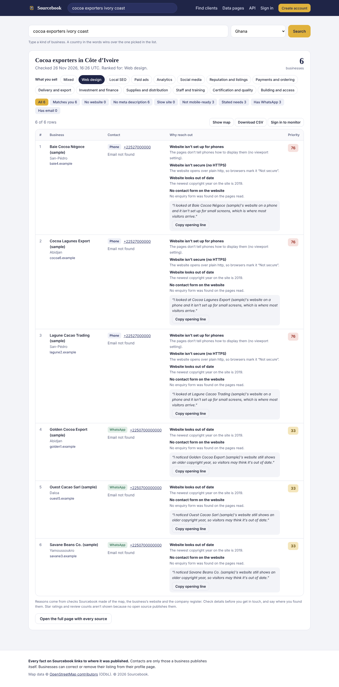
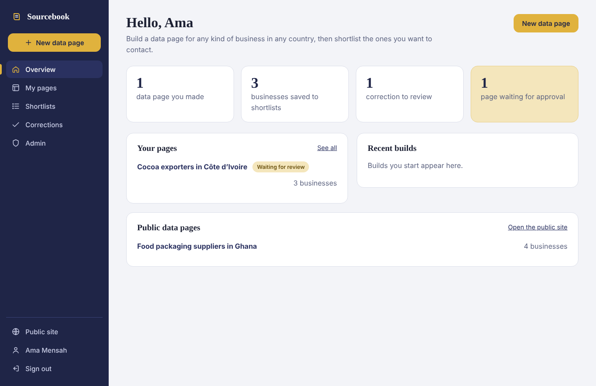
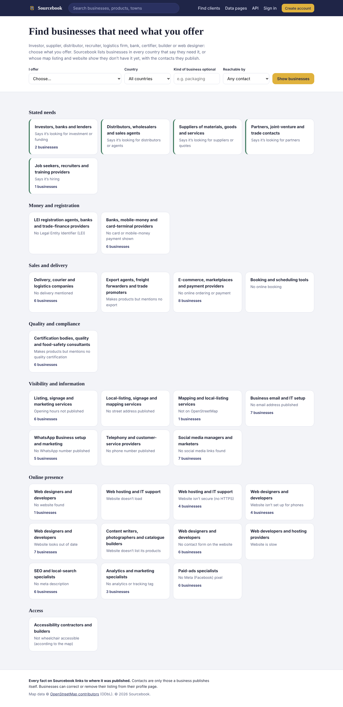
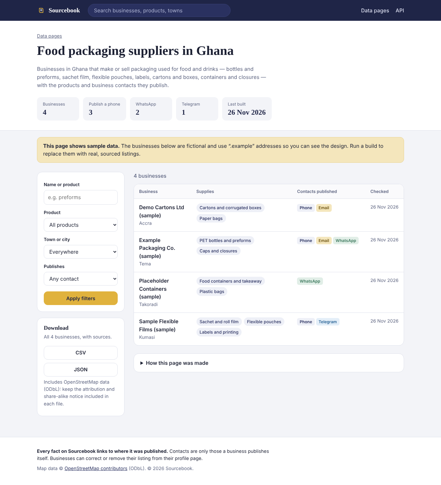
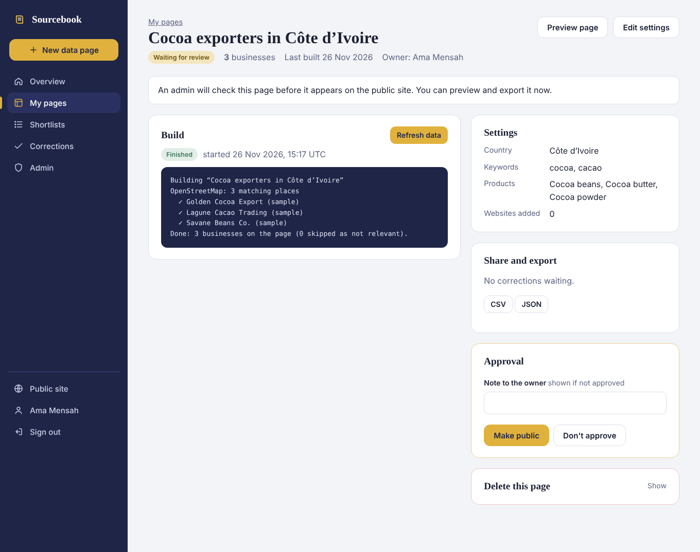

# Sourcebook

A web application of public data pages about businesses, for builders and researchers. Each fact links to where it was published.

- **Public site.** Anyone can browse, search and download the data pages without an account.
- **Workspace.** Anyone can create a free account. Members can:
  - build a new data page from the browser (for example "cocoa exporters in Côte d'Ivoire") and watch it build live;
  - keep shortlists of businesses, with notes, and download them as CSV;
  - review corrections sent about businesses on their own pages.
- **Admin.** New pages go public only after an admin approves them. Admins also see every build and manage accounts.

- **Search collects new data.** Search for any kind of business in any country, for example "cocoa exporters Côte d'Ivoire". Sourcebook shows what it already has, then searches every source and adds new businesses to the screen as it finds them.
- **The crawler covers every country.** Every hour it collects topics until the day's target of new businesses is reached: 1,000 by default, adjustable. Besides your own topics, it rotates 30 everyday business types (pharmacies, hardware stores, factories, logistics firms, clinics, wholesalers and more) through every country on earth. It searches by map tags, so names in any language are found. Each round queues 12 topics by default, about 290 a day.
- **Leads for whatever you sell.** Search "dentists in Austin" or "bakeries in Kumasi". Choose what you sell:
  - Web design, Local SEO, Paid ads, Analytics or Social media;
  - Reputation and listings, Payments and ordering, Delivery and export;
  - Investment and finance, Supplies and distribution, Staff and training;
  - Certification and quality, Building and access, or Mixed.

  Each business then gets a priority score, the reasons to reach out with what was observed, and an opening line you can copy. Filter tabs show counts: All, Matches you, No website, No meta description, Slow site, Not mobile-ready, Stated needs, Has WhatsApp and Has email. Results also have a map, CSV export with scores, search history, and up to 10 **monitors** that re-check a search daily and count new businesses. Searches are re-checked if their results are more than 6 hours old (`SOURCEBOOK_FRESH_HOURS`).
- **What each business needs or doesn't have yet.** Every profile lists the gaps Sourcebook found, such as no website, a site that doesn't work on phones, no HTTPS, no online ordering, no WhatsApp, no email, no social media, or not on the map. Each gap shows who could help. **Find clients** lists the businesses missing what you offer, with the contacts they publish.





## Where search and the crawler look

| Source | What it gives | Licence |
|---|---|---|
| OpenStreetMap | Mapped businesses whose names or tags match, with tagged contacts | ODbL: keep the attribution and share-alike notice |
| Wikidata | Companies in that country whose name or industry matches, with website, phone and head office | CC0 |
| GLEIF (Legal Entity Identifiers) | Officially registered companies with legal name and address | CC0 |
| Web search (optional) | Business websites found through the Brave Search API. Set `BRAVE_API_KEY`; the free tier covers about 1,000 searches a month. A result is kept only if its own website mentions the topic. | Only result links are used |
| Each business's own website | Contacts, products and description, plus the checks behind the gaps | Up to 4 pages per site, following robots.txt |

Sourcebook doesn't scrape Google, Facebook or business directories. They forbid it, block it, and get servers banned.

## What each business needs or doesn't have yet

These aren't only website problems. Sourcebook records:
- **needs the business states on its own site:** looking for investors, distributors, suppliers (including tenders and requests for quotation), partners, or hiring. These are detected in English, French, Spanish and Portuguese and saved with a short quote.
- **money and registration:** no LEI in the GLEIF register; no card or mobile-money payment.
- **sales and delivery:** no delivery; makes products but mentions no export; no online ordering; no online booking for appointment-type businesses.
- **quality:** makes products but mentions no certification, such as ISO, HACCP, GMP, organic, halal or a national standards mark.
- **visibility:** no opening hours, no street address, not on the map, no email, WhatsApp or phone.
- **access:** marked not wheelchair accessible on the map.
- **online presence:** the website checks below, plus slow site (3 seconds or more), no meta description, no analytics tag and no Meta pixel.

Online-presence checks:

| Gap | How it's found | Who could help |
|---|---|---|
| No website | No source lists one | Web designers |
| Website doesn't load | The home page fails or returns an error | Hosting and IT support |
| No HTTPS | The site opens over plain http | Hosting and IT support |
| Not set up for phones | The pages have no viewport setting | Web designers |
| Looks out of date | The newest © year is 3 or more years old | Web designers |
| No online ordering or payment | No cart, checkout, "order online" or payment option (Paystack, Flutterwave, Hubtel and others) | E-commerce and payment providers |
| Doesn't list its products | None of the page's product terms appear on the site | Content and catalogue builders |
| No contact form | No enquiry form on the pages read | Web designers |
| No email, WhatsApp or phone | Not published on the site or in any source | Email setup, WhatsApp Business setup, telephony |
| No social media | The site doesn't link to Facebook, Instagram, LinkedIn or X | Social media managers |
| Not on OpenStreetMap | The business wasn't among the mapped places searched | Local-listing services |

Each gap is worded as something not found, with the date and the page checked, because a business may have something Sourcebook didn't see. **Find clients** (`/opportunities`) filters businesses by gap, country, kind of business and contact channel, and exports the results as CSV. Signed-in users can save them to a shortlist. Data page exports include `missing` and `who_could_help` columns.



## The crawler (Workspace → Crawler, admins only)

- **Topics:** a kind of business plus a country, repeated every 1, 2 or 4 weeks. **Add 40 starter topics** loads a list covering Ghana, Nigeria, Côte d'Ivoire, Kenya and more, from `datasets/crawl-targets.csv`.
- **Rounds:** every hour (`SOURCEBOOK_CRAWL_INTERVAL`, in seconds; `0` turns the schedule off), it queues the due topics, 4 per round by default, until today's target of new businesses is reached.
- **What you can watch:**
  - new businesses per day for the last 14 days, against the target;
  - the most common searches, each with **Crawl regularly**;
  - pages created by searches that haven't been reviewed yet.

Searches start their collection straight away and go ahead of scheduled crawling. Pages created by searches are visible straight away, marked "Collected automatically from a search". Search engines aren't asked to index them, and they stay out of the sitemap until an admin chooses **Make public**.

Each address (IP) can start 8 new searches an hour (`SOURCEBOOK_SEARCHES_PER_HOUR`). The same search within 7 days shows the saved results instead of collecting again. About 6 websites are read at once (`SOURCEBOOK_SITE_CONCURRENCY`). For 1,000 or more businesses a day, keep at least 40 topics active, add `BRAVE_API_KEY`, and raise the topics per round.

The first page is **Food packaging suppliers in Ghana**. It covers bottles and preforms, sachet film, pouches, labels, cartons, containers and closures. For each business it shows:

- the products it supplies;
- the contacts it publishes itself: phone, email, WhatsApp and Telegram;
- a short description written only from those facts;
- a source link and a "last checked" date on every detail;
- a form to suggest a correction, or to ask for the listing to be removed;
- CSV and JSON downloads, filtered or complete.



## Where the data comes from

| Source | What it gives | Rules |
|---|---|---|
| OpenStreetMap (Overpass API) | Places tagged as packaging businesses, or whose names suggest packaging, with their tagged contacts | © OpenStreetMap contributors, ODbL. Exports keep the attribution and share-alike notice. |
| The business's own website | Products, phone, email, WhatsApp/Telegram links, address, and its self-description | Reads at most 4 pages (home, contact, about, products). Follows robots.txt, waits 2 s between requests, and never logs in or submits forms. |
| Your curator list `datasets/*.seeds.csv` | Business websites you've found yourself (trade directories, trade fairs, referrals) | Only the name and website go in. Everything else is read from the business's own site. |
| Corrections | Fixes and removals | A reviewer approves each one before it shows. Applied fixes are labelled "correction". |

Nothing is made up. If a source doesn't publish a detail, the page leaves it blank. Businesses with no sign of packaging products are left out.

## Signing in: Google, Kenuxa Account or email

The sign-in and sign-up pages offer **Continue with Kenuxa Account** and **Continue with Google**, as well as email and
password. A first sign-in creates the account, or joins an existing account with the same confirmed email. The nine-dot menu,
top right, opens the other Kenuxa apps (Accounts, Bask, Heimdall).

- **Kenuxa Account** works out of the box with the public values every Kenuxa app shares. Register Sourcebook once by running
  `KENUXA ACCOUNTS/supabase/migrations/0004_heimdall_sourcebook.sql` in the Supabase SQL editor. Its return addresses are
  `https://kenuxa-sourcebook.onrender.com/auth/callback` and `http://127.0.0.1:8100/auth/callback`; if Sourcebook lives
  elsewhere, change them there. `KENUXA_SIGNIN=0` hides the button.
- **Google**: in Google Cloud Console > APIs & Services > Credentials, create an OAuth client ID (Web application) with the
  redirect URI `<your address>/auth/callback`, then set `GOOGLE_CLIENT_ID` and `GOOGLE_CLIENT_SECRET`.

## The workspace

| Screen | What you do there |
|---|---|
| Overview | See your pages, recent builds, shortlists, and corrections waiting for you |
| New data page | Enter the kind of business and the country. You can also add keywords, products to look for, websites you already know, and OpenStreetMap tags. |
| My pages | See each page's status (*Building*, *Waiting for review*, *Public* or *Not approved*), with a live build log. You can rebuild, stop a build, edit the settings, export or delete. |
| Shortlists | Save businesses from any profile, add notes, and download CSV with contacts |
| Corrections | Approve or reject fixes and removal requests for your pages. Admins see all of them. |
| Admin | Approve or reject new pages, take a page off the public site, see running builds, and make accounts admin or disable them |
| Account | Change your name or password, or delete your account |



**Who is admin?** Put your email in `SOURCEBOOK_ADMIN_EMAILS`. Accounts with those emails become admins when they sign up. If you leave it empty, the first account created becomes the admin. You can also run `python -m sourcebook make-admin you@example.com`.

**Limits for members** (admins have none):
- one build at a time;
- `SOURCEBOOK_DAILY_BUILDS` builds a day (default 5);
- `SOURCEBOOK_MAX_PAGES` pages each (default 20);
- `SOURCEBOOK_MAX_BUSINESSES` businesses checked per build (default 400).

Builds run in the background on the server, `SOURCEBOOK_WORKERS` at a time (default 2). They carry on if you close the tab, and they restart if the server restarts. Every public page is refreshed every `SOURCEBOOK_REFRESH_DAYS` days (default 7; `0` turns this off).

**Safety:**
- Passwords are hashed with scrypt.
- Sign-in uses a signed cookie that ends when the password changes.
- Every form carries a CSRF token.
- Sign-ins, sign-ups and corrections are rate-limited.
- Hidden honeypot fields catch spam bots.
- The website reader refuses private and local network addresses, so a member can't use it to reach the server's own network.

## Run it on your computer (Windows)

Double-click **Sourcebook.bat**. The first run installs what it needs and builds the Ghana page; this can take a while because websites are read politely. It then opens http://127.0.0.1:8100. Choose **Create account**: on your own computer, the first account becomes the admin.

Or from a terminal:

```
pip install -r requirements.txt
python -m sourcebook demo         # optional: fictional sample rows, clearly marked, to preview the design
python -m sourcebook build        # real build: OpenStreetMap + websites (replaces the sample)
python -m sourcebook serve        # http://127.0.0.1:8100
```

`build --no-websites` uses only OpenStreetMap and your list. Run `build` again whenever you want to refresh the data. Corrections you have already applied are kept.

### Better descriptions (optional)

Set `SOURCEBOOK_LLM=anthropic` and `ANTHROPIC_API_KEY=…` before you build. Claude then rewrites each description from the same facts and is told not to add anything new. Without these settings, Sourcebook uses plain template sentences.

## Add more suppliers

Add rows to `datasets/food-packaging-ghana.seeds.csv` (`name,website,city,notes`), then run `build` again.

## Make a new data page

Copy `datasets/food-packaging-ghana.json` and change:

- the slug, title and country;
- the OpenStreetMap tags and name pattern;
- the product terms to look for.

Then run `python -m sourcebook build datasets/your-page.json`.

## Corrections and removals

Every profile has a **Fix or remove this listing** form. What people send appears in **Workspace → Corrections**, for the page's owner and for admins. When you approve:

- **a correction** adds the new value with its evidence link, labelled as a correction;
- **a removal** hides the business from pages, search and exports.

## Downloads and API

- `/d/<page>.csv` and `/d/<page>.json`: add the same `?product=…&city=…&channel=whatsapp` filters as the page.
- `/api/datasets`: every data page, with download links.
- `/sitemap.xml`: every page is server-rendered so search engines can index it. Data pages carry schema.org `Dataset` markup.

## Put it online (Render)

1. Push this folder to GitHub.
2. In Render, choose **New → Blueprint** and pick the repo. `render.yaml` sets up the web service, a 1 GB disk for the database, and a generated cookie secret.
3. When Render asks, fill in:
   - `SOURCEBOOK_ADMIN_EMAILS`: your email;
   - `SOURCEBOOK_PUBLIC_URL`: your site address, for example `https://sourcebook.onrender.com`. Export links and the sitemap use it, and sign-in cookies become HTTPS-only.
4. Open the site and sign up with that email to become the admin. The first start builds the Ghana page in the background.

Accounts, pages and shortlists live in the database on that disk. The free plan has no disk, so everything would be lost on every restart. Use the Starter plan or higher.

## Privacy

Sourcebook lists businesses, not people. It only shows contacts that a business published itself. Anyone can ask for a correction, and a business can ask for its listing to be removed. Before you publish, read Ghana's Data Protection Act, 2012 (Act 843), and register with the Data Protection Commission if it applies to you. This is not legal advice.

## Tests

```
pip install pytest && python -m pytest -q
```

The tests use canned OpenStreetMap and website responses, so they don't need the internet. They cover:
- the collectors;
- builds;
- exports;
- corrections;
- sign-up, roles and CSRF;
- building a page in the browser and having it approved;
- shortlists;
- build limits;
- blocking private network addresses;
- the Wikidata, GLEIF and web search readers;
- turning searches into topics and merging duplicates;
- gap checks;
- searches that collect live;
- Find clients;
- crawler rounds and the Crawler screen.

## Next

- **Who might use what I built?** This goes beyond the gap list: describe a product in your own words and have it matched to buyers.
- **Email:** password reset links and alerts when a build finishes. This needs an email service such as Postmark or Resend.
- **Investor search** on the same foundation.
